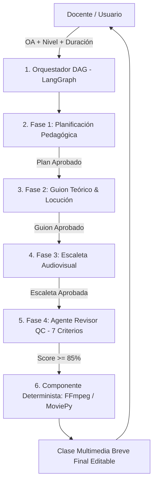

# Guía de Funcionamiento y Verificación del Sistema Multiagente (Proyecto 3)

## Explicación de Operación, Arquitectura DAG, Casos de Prueba y Alcance del Prototipo

> **Aviso Importante sobre la Naturaleza del Prototipo (Entrega 1 - E1):**  
> La presente interfaz web en HTML5, CSS3 y JavaScript corresponde a un **Prototipo Frontend de Demostración (Prueba de Concepto - PoC)** desarrollado para la primera entrega del Seminario de Titulación. Su objetivo es ilustrar visualmente la experiencia de usuario, la orquestación secuencial de agentes y el reporte de calidad pedagógica.  
> 
> **Alcance del Trabajo Final (Fases II a V):**  
> El sistema final del proyecto será un **software integral con backend en Python 3.11+ (FastAPI + LangGraph)**, conectado mediante API Keys a modelos de lenguaje reales (LLMs como GPT-4o, Gemini o el sistema de cuotas institucional de la universidad) y a un motor determinista de renderizado de video (**FFmpeg / MoviePy**).

---

### 1. ¿Qué es y qué problema resuelve la aplicación?

El programa es una **plataforma interactiva de IA Multiagente** diseñada para generar propuestas de clases multimedia coherentes, evitando la desalineación pedagógica y comunicacional producida por modelos monolíticos de un solo prompt.

Para **reducir el riesgo técnico**, la primera versión (MVP) de la solución se enfoca exclusivamente en la generación secuencial de una **clase multimedia breve** (15 a 20 minutos de desarrollo conceptual), estructurada a partir de:
1. Objetivo de Aprendizaje (OA).
2. Nivel Educativo.
3. Duración Estimada.
4. Enfoque Didáctico y Contexto del Curso.

---

### 2. Arquitectura Interna: Flujo DAG Secuencial & Loops de Revisión

A diferencia de un flujo en paralelo, la aplicación opera mediante un **Grafo Acíclico Dirigido (DAG)** orquestado en **LangGraph**, donde la salida aprobada de cada agente alimenta a la etapa siguiente:



#### Ciclos Acotados de Revisión (Loops de 4 Pasos):
Cada fase del DAG ejecuta internamente un loop acotado antes de enviar la información a la siguiente etapa:
$$\text{Producir} \longrightarrow \text{Verificar} \longrightarrow \text{Corregir} \longrightarrow \text{Aprobar}$$

---

### 3. Matriz de Auditoría del Agente Revisor (7 Tópicos de Calidad)

El Agente Revisor (Quality Control) audita la propuesta evaluando **7 criterios específicos**:

1. **Alineación OA vs. Contenido:** Comprueba que la clase responda directamente al objetivo didáctico.
2. **Exactitud Conceptual y Lenguaje:** Audita el rigor técnico y la adaptación al nivel educativo.
3. **Coherencia entre Escenas y Cobertura:** Verifica una transición narrativa continua sin lagunas.
4. **Factibilidad de Duración:** Valida que los tiempos asignados sean realistas para la duración de la clase.
5. **Correspondencia Locución - Imagen - Texto:** Asegura sincronía entre voz hablada, gráficos y texto visible.
6. **Densidad de Información por Escena:** Controla la carga cognitiva evaluando texto vs. permanencia en pantalla.
7. **Trazabilidad de Fuentes y Verificación:** Identifica afirmaciones técnicas que requieren validación de fuentes.

---

### 4. Guía Paso a Paso para la Evaluación: Los 6 Casos de Prueba

A continuación se detallan los **6 casos de prueba** diseñados para comprobar el funcionamiento integral del prototipo web:

#### **Caso de Prueba 1: Ejemplo Rápido 1-Click (Física - Conservación de Energía)**
1. **Acción:** Hacer clic en el botón superior **`Física: Conservación Energía`**. (Si se vuelve a hacer clic sobre el botón activo, este se desmarca limpiamente).
2. **Ejecución:** Hacer clic en **`Ejecutar Grafo DAG (LangGraph)`**.
3. **Resultado a verificar:**
   - La terminal anima el flujo en vivo por fases (*Orquestador ➔ Planificación ➔ Guion Teórico ➔ Escaleta Audiovisual ➔ Revisor QC ➔ Ensamblador FFmpeg*).
   - En la pestaña **`1. Planificación`**, se visualizan las 3 etapas (Inicio, Desarrollo, Cierre).
   - En la pestaña **`2. Guion Teórico`**, el glosario se muestra perfectamente alineado dentro del recuadro.
   - En la pestaña **`3. Escaleta Audiovisual`**, se incluye el guion de video de 3 escenas y la ecuación de conservación $E_{total} = E_c + E_p$.
   - En la pestaña **`4. Auditoría Revisor`**, se despliega el **Score del 94%** y la pauta verde de los 7 criterios.

#### **Caso de Prueba 2: Ejemplo Rápido 1-Click (Biología - Fotosíntesis)**
1. **Acción:** Hacer clic en **`Biología: Fotosíntesis`** y luego en **`Ejecutar Grafo DAG (LangGraph)`**.
2. **Resultado a verificar:**
   - Carga el nivel `Primaria (5º - 6º)` y el enfoque `Aprendizaje Basado en Problemas (ABP)`.
   - Muestra el experimento *"Burbujas de Oxígeno"*.
   - El cuadro del prompt para la infografía infantil se ajusta automáticamente con salto de línea sin desbordar la pantalla hacia la derecha.

#### **Caso de Prueba 3: Ejemplo Rápido 1-Click (Historia - Revolución Industrial)**
1. **Acción:** Hacer clic en **`Historia: Rev. Industrial`** y ejecutar el grafo.
2. **Resultado a verificar:**
   - Carga el nivel `Bachillerato / Media` y el enfoque `Modelo de Indagación 5E`.
   - Se genera el contenido teórico sobre la máquina de vapor y la escaleta para video documental histórico.

#### **Caso de Prueba 4: Entrada con Objetivo de Aprendizaje (OA) Personalizado**
1. **Acción:** Ingresar un OA personalizado en la casilla de texto, por ejemplo:
   > *"Comprender el ciclo hidrológico del agua y evaluar el impacto de la contaminación por microplásticos en los océanos."*
2. **Parámetros:** Seleccionar `Educación Superior / Univ.` y duración `30 Minutos`.
3. **Ejecución:** Hacer clic en **`Ejecutar Grafo DAG (LangGraph)`**.
4. **Resultado a verificar:**
   - Todas las pestañas (*Planificación, Guion Teórico y Escaleta Audiovisual*) construyen automáticamente tarjetas dinámicas adaptadas al tema de microplásticos y ciclo del agua.

#### **Caso de Prueba 5: Edición Directa In-Situ (Modo Edición)**
1. **Acción:** Hacer clic en el botón **`Editar Contenido`** (botón superior con lápiz).
2. **Verificación:** El botón pasa a color azul (**`Guardar Cambios`**) y permite modificar o corregir cualquier texto en pantalla directamente como en un procesador de texto (Word).
3. **Guardar:** Al hacer clic en **`Guardar Cambios`**, los cambios quedan fijados.

#### **Caso de Prueba 6: Exportación Markdown (MD) e Impresión a PDF**
1. **Exportación Markdown:** Hacer clic en **`Exportar (MD)`**.
   - **Resultado:** Descarga un archivo `.md` estructurado (`Propuesta_Clase_Breve_...md`) con el contenido completo de las 4 pestañas.
2. **Impresión / PDF:** Hacer clic en **`Imprimir / PDF`**.
   - **Resultado:** Se abre la ventana de impresión nativa configurada para ocultar botones y desplegar todo el informe completo (las 4 secciones secuenciales) en un documento PDF listo para guardar o imprimir.

---

### 5. Instrucciones de Ejecución Local

Para visualizar y probar la demostración interactiva en un entorno local:

#### Opción 1: Servidor HTTP en Python (Recomendado)
```bash
python -m http.server 8080
```
Abrir en el navegador: `http://localhost:8080`

#### Opción 2: Apertura Directa
Hacer doble clic sobre el archivo [`index.html`](file:///d:/Codigos%20de%20prueba/seminario%20de%20lin/index.html).

---

### 6. Stack Tecnológico del Proyecto

- **Frontend Prototipo:** HTML5 Semántico, CSS3 Vanilla (Glassmorphism), JavaScript ES6+ ([`app.js`](file:///d:/Codigos%20de%20prueba/seminario%20de%20lin/app.js)).
- **Backend Multiagente (Fase II):** Python 3.11+, FastAPI, **LangGraph** (Gestión de grafos de estado y loops).
- **Motor Determinista de Video:** **FFmpeg / MoviePy** para el renderizado de escenas y locución.
- **Modelos LLM:** GPT-4o / Claude 3.5 Sonnet / Gemini Pro / Sistema de Cuotas Institucional.
