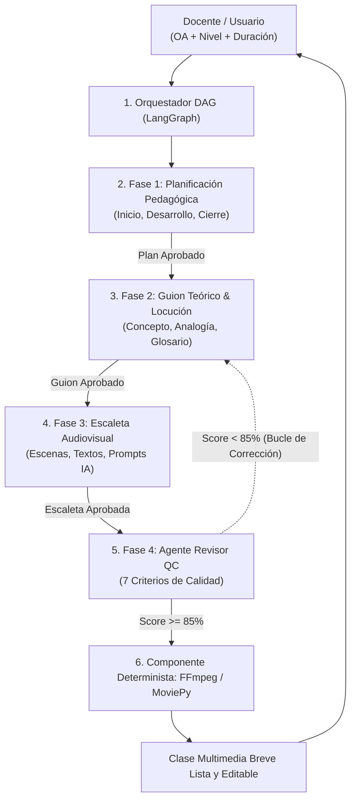

# Guía de Funcionamiento y Verificación del Sistema Multiagente (Proyecto 3)

## Explicación de Operación, Arquitectura DAG, Casos de Prueba y Verificación de Extremo a Extremo

> **Estado Actual del Sistema (Fase II Operativa):**  
> El sistema cuenta actualmente con una **arquitectura completa y funcional de extremo a extremo**:
> 1. **Backend en Python 3.11+:** Servidor API RESTful con **FastAPI** y motor de orquestación de grafos con **LangGraph**.
> 2. **Conexión a Modelos de Lenguaje (LLMs):** Integración activa con **OpenAI (`gpt-4o-mini`)** mediante `langchain-openai`, generando en tiempo real la planificación didáctica, el marco conceptual, las escenas audiovisuales y el reporte de calidad.
> 3. **Frontend Interactivo:** Interfaz web en HTML5, CSS3 y JavaScript con sincronización asíncrona en tiempo real con el backend, modo de edición in-situ y exportación a Markdown/PDF. Si el backend no está activo, cuenta con un mecanismo de resiliencia que conmuta a modo local sin interrumpir la experiencia.

---

### 1. ¿Qué es y qué problema resuelve la aplicación?

El programa es una **plataforma interactiva de IA Multiagente** diseñada para generar propuestas de clases multimedia breves y pedagógicamente coherentes, evitando la desalineación didáctica y comunicacional producida por modelos monolíticos de un solo prompt.

Para **reducir el riesgo técnico**, la primera versión (MVP) de la solución se enfoca en la generación estructurada de una **clase multimedia breve** (15 a 20 minutos de desarrollo conceptual), parametrizada a partir de cuatro insumos fundamentales:
1. **Objetivo de Aprendizaje (OA).**
2. **Nivel Educativo** (Primaria, Secundaria, Bachillerato o Educación Superior).
3. **Duración Estimada** de la sesión.
4. **Enfoque Didáctico y Contexto** del curso (Clase Invertida, ABP, Indagación 5E, STEM).

---

### 2. Arquitectura Interna: Flujo DAG Secuencial & Loops de Revisión

A diferencia de un flujo desordenado o en paralelo, la aplicación opera mediante un **Grafo Acíclico Dirigido (DAG)** orquestado en **LangGraph** (`StateGraph`), donde la salida aprobada de cada agente alimenta a la etapa siguiente:



#### Ciclos Acotados de Revisión (Loops de 4 Pasos):
Cada fase del DAG ejecuta internamente un ciclo estructurado antes de transferir su estado a la siguiente etapa:
$$\text{Producir} \longrightarrow \text{Verificar} \longrightarrow \text{Corregir} \longrightarrow \text{Aprobar}$$

---

### 3. Matriz de Auditoría del Agente Revisor (7 Criterios de Calidad)

El Agente Revisor (Quality Control) audita la propuesta evaluando **7 criterios específicos** con ponderaciones predefinidas:

1. **Alineación OA vs. Contenido (20%):** Comprueba que la clase responda de forma explícita al objetivo didáctico.
2. **Exactitud Conceptual y Lenguaje (15%):** Audita el rigor técnico y la adaptación del vocabulario al nivel educativo.
3. **Coherencia entre Escenas y Cobertura (15%):** Verifica una transición narrativa continua sin lagunas conceptuales.
4. **Factibilidad de Duración (10%):** Valida que la asignación temporal sea realista para la duración estipulada.
5. **Correspondencia Locución - Imagen - Texto (15%):** Asegura sincronía entre la voz hablada, los gráficos y el texto en pantalla.
6. **Densidad de Información por Escena (10%):** Controla la carga cognitiva evaluando texto vs. permanencia visual.
7. **Trazabilidad de Fuentes y Verificación (15%):** Valida que las afirmaciones técnicas y analogías sean conceptualmente trazables.

* **Umbral de Aprobación:** $\ge 85\%$. Si no se alcanza el umbral y quedan iteraciones disponibles (`max_iterations = 2`), el orquestador activa la arista condicional para reintentar la fase observada.

---

### 4. Guía Paso a Paso para la Evaluación: Los 6 Casos de Prueba

A continuación se detallan los **6 casos de prueba** diseñados para comprobar el funcionamiento integral del sistema (tanto vía web conectada al backend como en modo demostración):

#### **Caso de Prueba 1: Ejemplo Rápido 1-Click (Física - Conservación de Energía)**
1. **Acción:** Hacer clic en el botón superior **`Física: Conservación Energía`**. (Si se vuelve a hacer clic sobre el botón activo, este se desmarca limpiamente).
2. **Ejecución:** Hacer clic en **`Ejecutar Grafo DAG (LangGraph)`**.
3. **Resultado a verificar:**
   - La terminal web refleja el avance por fases (*Orquestador ➔ Planificación ➔ Guion Teórico ➔ Escaleta Audiovisual ➔ Revisor QC ➔ Ensamblador*).
   - Con el backend activo, el badge superior cambia a color azul: **`LANGGRAPH BACKEND ACTIVO (XX% APROBADO)`**.
   - En la pestaña **`1. Planificación`**, se visualizan las 3 etapas didácticas dosificadas temporalmente.
   - En la pestaña **`2. Guion Teórico`**, se muestra el concepto central, la analogía cotidiana y el glosario técnico.
   - En la pestaña **`3. Escaleta Audiovisual`**, se despliegan las escenas con locución, texto y prompts para IA generativa visual.
   - En la pestaña **`4. Auditoría Revisor`**, se visualiza el **Score Global** y la rúbrica de los 7 criterios.

#### **Caso de Prueba 2: Ejemplo Rápido 1-Click (Biología - Fotosíntesis)**
1. **Acción:** Hacer clic en **`Biología: Fotosíntesis`** y luego en **`Ejecutar Grafo DAG (LangGraph)`**.
2. **Resultado a verificar:**
   - Se parametriza el nivel `Primaria (5º - 6º)` y el enfoque `Aprendizaje Basado en Problemas (ABP)`.
   - Se genera una explicación adaptada al lenguaje escolar con analogías accesibles y actividades vivenciales.
   - Los prompts de imágenes se adaptan a estilo infografía educativa infantil.

#### **Caso de Prueba 3: Ejemplo Rápido 1-Click (Historia - Revolución Industrial)**
1. **Acción:** Hacer clic en **`Historia: Rev. Industrial`** y ejecutar el grafo.
2. **Resultado a verificar:**
   - Se parametriza el nivel `Bachillerato / Media` y el enfoque `Modelo de Indagación 5E`.
   - El guion teórico aborda la transición fabril y la máquina de vapor, y la escaleta diseña un video documental.

#### **Caso de Prueba 4: Entrada con Objetivo de Aprendizaje (OA) Personalizado**
1. **Acción:** Ingresar un OA libre en la casilla de texto, por ejemplo:
   > *"Comprender el ciclo del agua y evaluar el impacto de los microplásticos en los ecosistemas marinos."*
2. **Parámetros:** Seleccionar `Educación Superior / Univ.` y duración `30 Minutos`.
3. **Ejecución:** Hacer clic en **`Ejecutar Grafo DAG (LangGraph)`**.
4. **Resultado a verificar:**
   - Con el backend conectado, **GPT-4o mini** genera desde cero un contenido exclusivo y adaptado al tema de microplásticos y ciclo del agua para nivel universitario.
   - En la consola del navegador (`F12`) se registra el log `[DAG Frontend] ✅ Respuesta exitosa recibida del backend LangGraph`.

#### **Caso de Prueba 5: Edición Directa In-Situ (Modo Edición)**
1. **Acción:** Hacer clic en el botón superior con el lápiz (**`Editar Contenido`**).
2. **Verificación:** El botón conmuta a azul (**`Guardar Cambios`**) y habilita la edición libre de cualquier texto en pantalla directamente, como en un procesador de texto.
3. **Guardar:** Al hacer clic en **`Guardar Cambios`**, los textos corregidos por el docente quedan consolidados.

#### **Caso de Prueba 6: Exportación Markdown (MD) e Impresión a PDF**
1. **Exportación Markdown:** Hacer clic en **`Exportar Markdown (.md)`**.
   - **Resultado:** Descarga inmediatamente un archivo `.md` estructurado y listo para usar en plataformas educativas.
2. **Impresión / PDF:** Hacer clic en **`Imprimir / Guardar en PDF`**.
   - **Resultado:** Se abre el diálogo nativo de impresión con estilos CSS maquetados específicamente (`@media print`) que eliminan botones y presentan el documento completo paginado.

---

### 5. Instrucciones de Ejecución Local

Para reproducir y evaluar el sistema en local:

#### Requisitos Previos:
* Python 3.11 o superior.
* Archivo `.env` con variable `OPENAI_API_KEY` (modelo por defecto: `gpt-4o-mini`).

#### Paso 1: Instalación de Dependencias
```bash
pip install -r backend/requirements.txt
```
*(O de forma directa: `pip install langchain-openai langgraph fastapi uvicorn pydantic python-dotenv`)*

#### Paso 2: Prueba Autónoma del Grafo (Consola CLI)
Para verificar la orquestación multiagente en LangGraph sin necesidad de levantar el navegador:
```bash
python backend/test_pipeline.py
```

#### Paso 3: Iniciar Servidor Backend (FastAPI)
En una terminal:
```bash
python -m uvicorn backend.app.main:app --reload --port 8000
```
*Documentación interactiva Swagger disponible en:* `http://127.0.0.1:8000/docs`

#### Paso 4: Iniciar Cliente Web (Frontend)
En una segunda terminal en la raíz del proyecto:
```bash
python -m http.server 8080 --bind 127.0.0.1
```
Abrir en el navegador: **`http://localhost:8080`**

---

### 6. Stack Tecnológico del Proyecto

* **Frontend:** HTML5 Semántico, CSS3 Vanilla (Glassmorphism & Print Styles), JavaScript ES6+ (`app.js`).
* **Backend Multiagente (Fase II):** Python 3.11+, **FastAPI**, **LangGraph** (`StateGraph` y aristas condicionales), **LangChain / langchain-openai** (Validación estructurada mediante modelos Pydantic).
* **Modelos de Lenguaje:** OpenAI (`gpt-4o-mini` por defecto, arquitectura preparada para Gemini Pro y Claude 3.5 Sonnet).
* **Componente Determinista Multimedia:** Especificación JSON preparada para motor **FFmpeg / MoviePy**.
