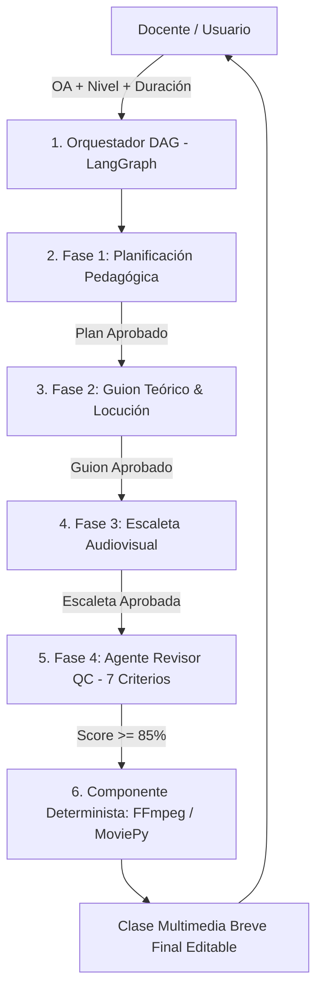

# Guía de Funcionamiento del Sistema Multiagente (Proyecto 3)

## Explicación Sencilla de Operación, Arquitectura DAG, Flujo y Entregables del Prototipo

> **Aviso Importante sobre esta Versión de Demostración:**  
> Los datos, puntajes e informes de evaluación mostrados en este prototipo web interactivo corresponden a una **simulación de prueba de concepto (PoC)**. Tienen la finalidad de ilustrar visualmente el comportamiento del Grafo Acíclico Dirigido (DAG) y la matriz de auditoría antes de conectar el backend a los modelos de lenguaje (LLMs) y herramientas deterministas.

---

### 1. ¿Qué es y qué problema resuelve la aplicación?

El programa es una **plataforma interactiva de IA Multiagente** diseñada para generar clases multimedia coherentes, evitando la desalineación pedagógica y comunicacional producida por los modelos monolíticos (un solo prompt).

Para **reducir el riesgo técnico**, la primera versión (MVP) de la solución se enfoca exclusivamente en la generación secuencial de una **clase multimedia breve** (15 a 20 minutos de desarrollo conceptual), estructurada a partir de:
1. Objetivo de Aprendizaje (OA).
2. Nivel Educativo.
3. Duración Estimada.
4. Enfoque Didáctico y Contexto del Curso.

---

### 2. Arquitectura Interna: Flujo DAG Secuencial & Loops de Revisión

A diferencia de un flujo en paralelo, la aplicación opera mediante un **Grafo Acíclico Dirigido (DAG)** orquestado con **LangGraph**, donde cada agente produce un resultado verificado que alimenta a la etapa siguiente:



#### Ciclos Acotados de Revisión (Loops de 4 Pasos):
Cada fase del DAG ejecuta internamente un loop acotado antes de enviar la información a la siguiente etapa:
$$\text{Producir} \longrightarrow \text{Verificar} \longrightarrow \text{Corregir} \longrightarrow \text{Aprobar}$$

---

### 3. Matriz de Auditoría del Agente Revisor (7 Tópicos de Calidad)

El Agente Revisor (Quality Control) audita la propuesta evaluando **7 criterios específicos** derivados de la retroalimentación docente:

1. **Alineación OA vs. Contenido:** Comprueba que la clase responda directamente al objetivo didáctico.
2. **Exactitud Conceptual y Lenguaje:** Audita el rigor técnico y la adaptación al nivel educativo.
3. **Coherencia entre Escenas y Cobertura:** Verifica una transición narrativa continua sin lagunas.
4. **Factibilidad de Duración:** Valida que los tiempos asignados sean realistas para la duración de la clase.
5. **Correspondencia Locución - Imagen - Texto:** Asegura sincronía entre voz hablada, gráficos y texto visible.
6. **Densidad de Información por Escena:** Controla la carga cognitiva evaluando texto vs. permanencia en pantalla.
7. **Trazabilidad de Fuentes y Verificación:** Identifica afirmaciones técnicas que requieren validación de fuentes.

---

### 4. Guía Paso a Paso: ¿Cómo se usa el prototipo web?

1. **Ejecutar o Abrir la Aplicación:**
   - Hacer doble clic en [`index.html`](file:///d:/Codigos%20de%20prueba/seminario%20de%20lin/index.html) o iniciar el servidor estático local con:
     ```bash
     python -m http.server 8080
     ```
   - Acceder en el navegador web a `http://localhost:8080`.
2. **Seleccionar o Ingresar Parámetros:**
   - Usar los botones de **ejemplo rápido (1-Click)** para Física (*Conservación de la Energía*), Biología (*Fotosíntesis*) o Historia (*Revolución Industrial*), o escribir un Objetivo de Aprendizaje personalizado.
3. **Ejecutar el Grafo DAG:**
   - Hacer clic en el botón **"Ejecutar Grafo DAG (LangGraph)"**.
4. **Observar la Secuencia en Vivo:**
   - Monitorear en la grilla visual el avance secuencial por fases (*Orquestador ➔ Planificación ➔ Guion ➔ Audiovisual ➔ Revisor QC ➔ Ensamblador FFmpeg*).
5. **Navegar por las Pestañas del Resultado:**
   - **1. Planificación:** Estructura temporal y momentos didácticos.
   - **2. Guion Teórico:** Contenido conceptual, locución y glosario.
   - **3. Escaleta Audiovisual:** Desglose escena por escena (locución, imagen, texto superpuesto) y prompts visuales.
   - **4. Auditoría Revisor:** Desglose de los 7 tópicos evaluados con score global.
6. **Edición in-situ y Exportación:**
   - Hacer clic en **"Editar Contenido"** para modificar el texto generado directamente en pantalla.
   - Usar el botón **"Exportar (MD)"** para descargar la propuesta en formato Markdown.

---

### 5. Componentes y Stack Tecnológico del Proyecto

- **Frontend Prototipo:** HTML5 Semántico, CSS3 Vanilla (Glassmorphism), JavaScript ES6+ ([`app.js`](file:///d:/Codigos%20de%20prueba/seminario%20de%20lin/app.js)).
- **Backend Multiagente (Fase II):** Python 3.11+, FastAPI, **LangGraph** (Gestión de grafos de estado y loops).
- **Motor Determinista de Video:** **FFmpeg / MoviePy** para la renderización de escenas y locución.
- **Modelos LLM:** GPT-4o / Claude 3.5 Sonnet / Gemini Pro.
