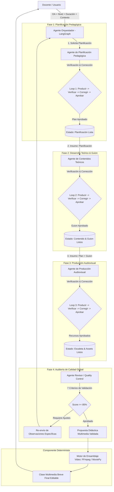

# Documento de Propuesta Técnica
## Proyecto 3: Sistema de IA Multiagente para el Diseño de Clases Multimedia Coherentes y Editables

---

### 1. Resumen Ejecutivo
El presente proyecto aborda la problemática de la **desalineación pedagógica, curricular y comunicacional** que ocurre al utilizar modelos de Inteligencia Artificial Generativa aislados o monolíticos para la preparación de material educativo.

Para **reducir el riesgo técnico**, la primera versión (MVP) de la solución se concentra exclusivamente en la generación secuencial de una **clase multimedia breve**, estructurada a partir de un *Objetivo de Aprendizaje (OA), nivel educativo, duración estimada y características del curso*.

El sistema se basa en un **Grafo Acíclico Dirigido (DAG) de Agentes de IA**, orquestado mediante **LangGraph**, donde la salida de cada etapa sirve de insumo verificado para la siguiente. El proceso culmina en un componente determinista separado (**FFmpeg / MoviePy**) encargado del ensamblaje del recurso multimedia final.

---

### 2. Justificación del Enfoque Multiagente Secuencial (DAG) vs. Monolítico

#### ¿Por qué falla un único prompt o LLM monolítico?
- **Alucinación y dispersión de objetivos:** Al intentar generar planificación, contenido, actividades, evaluación y guiones en un solo llamado, el modelo pierde el foco sobre el Objetivo de Aprendizaje (OA).
- **Inconsistencia de tono y nivel:** La explicación teórica puede redactarse para nivel universitario mientras que la actividad práctica resulta demasiado infantil o simple.
- **Ausencia de control de calidad intrínseco:** Los modelos monolíticos son "complacientes" y no auditan críticamente la alineación pedagógica ni la correspondencia entre locución e imágenes.

#### Ventajas de la Arquitectura DAG por Fases con Loops Acotados
- **Dependencias Reales:** El recurso audiovisual no puede diseñarse hasta que la planificación pedagógica y el guion de contenido teórico estén definidos y aprobados.
- **Ciclos de Revisión Localizados (Loops):** Cada fase cuenta con un ciclo interno de 4 pasos: **`Producir ➔ Verificar ➔ Corregir ➔ Aprobar`** antes de avanzar a la siguiente etapa.
- **Ensamblaje Determinista:** Separación clara entre la generación inteligente (LLMs) y la producción multimedia final ejecutada mediante herramientas deterministas (FFmpeg / MoviePy).

---

### 3. Arquitectura del Sistema (DAG Secuencial por Fases)



---

### 4. Especificación Detallada de Agentes y Roles

| Agente / Componente | Responsabilidad Principal | Skills Específicas | Formato de Salida |
| :--- | :--- | :--- | :--- |
| **Orquestador (LangGraph)** | Gestión de estados, grafo de dependencias y flujo de control. | • Definición de nodos y aristas del DAG<br>• Transición condicional entre fases<br>• Control de máximo de iteraciones en loops | Grafo de Estado JSON |
| **Planificador Pedagógico** | Diseño del marco temporal y metodológico de la clase breve. | • Dosificación de tiempos (Inicio, Desarrollo, Cierre)<br>• Definición del modelo didáctico (ABP, 5E, Aula Invertida)<br>• Prerrequisitos y alineación con el OA | Esquema temporal didáctico |
| **Contenidos Teóricos** | Redacción del guion didáctico principal. | • Redacción conceptual clara adaptada al nivel<br>• Analogías explicativas y glosario clave<br>• Texto visible y locución recomendada | Guion Teórico Modular |
| **Producción Audiovisual** | Diseño de escaleta multimedia y prompts de recursos. | • Escaleta escena por escena para video corto<br>• Prompts para generación de imágenes/infografías<br>• Indicaciones de tiempo por escena y locución | Escaleta Multimedia + Prompts |
| **Agente Revisor (QC)** | Auditoría integral basada en 7 criterios de calidad. | • Evaluación de los 7 tópicos pedagógicos y comunicacionales<br>• Cálculo del Score de Coherencia Pedagógica<br>• Emisión de reporte de observaciones por agente | Reporte de Auditoría + Score |
| **Ensamblador Video (FFmpeg/MoviePy)** | Generación determinista del archivo multimedia. | • Renderizado de video a partir de audio/imágenes<br>• Sincronización de locución y texto en pantalla<br>• Exportación en formato MP4 / WebM | Video MP4 / Assets Editables |

---

### 5. Matriz de Auditoría del Agente Revisor (7 Criterios de Calidad)

El Agente Revisor audita la propuesta utilizando una matriz cualitativa estructurada en **7 tópicos obligatorios**:

| # | Criterio de Auditoría | Descripción y Verificación | Peso |
| :-: | :--- | :--- | :-: |
| **1** | **Alineación OA vs. Contenido** | Garantiza que cada sección del guion responda directamente al Objetivo de Aprendizaje. | 20% |
| **2** | **Exactitud Conceptual y Lenguaje** | Verifica la precisión técnica del texto y la adecuación del vocabulario al nivel educativo. | 15% |
| **3** | **Coherencia de Escenas y Cobertura** | Asegura que la secuencia temática sea fluida y no deje vacíos en el objetivo. | 15% |
| **4** | **Factibilidad Temporal** | Valida que la cantidad de contenido sea realista para la duración configurada de la clase. | 10% |
| **5** | **Correspondencia Locución - Imagen - Texto** | Audita que la locución hablada, las imágenes proyectadas y los textos legibles coincidan exactamente. | 15% |
| **6** | **Densidad de Información por Escena** | Evita la sobrecarga cognitiva evaluando la cantidad de texto según el tiempo de permanencia en pantalla. | 10% |
| **7** | **Trazabilidad y Verificación de Fuentes** | Identifica afirmaciones técnicas que requieren verificación y rastrea el origen conceptual. | 15% |

```json
{
  "score_global_coherencia": "88%",
  "estado": "APROBADO",
  "matriz_criterios": {
    "1_alineacion_oa_contenido": 95,
    "2_exactitud_conceptual_lenguaje": 90,
    "3_coherencia_escenas_cobertura": 85,
    "4_factibilidad_temporal": 90,
    "5_correspondencia_locucion_imagen_texto": 85,
    "6_densidad_informacion_escena": 80,
    "7_trazabilidad_fuentes_verificacion": 90
  },
  "observaciones_agentes": []
}
```

Si el `score_global_coherencia` es inferior al **85%**, el Revisor retorna las observaciones especificando qué agente debe corregir el módulo antes del ensamblaje.

---

### 6. Estructura de Entradas y Salidas del Sistema

#### Entradas (Input del Docente):
- **Objetivo de Aprendizaje (OA):** "Explicar el funcionamiento de la fotosíntesis y su importancia en los ecosistemas."
- **Nivel Educativo:** Educación Secundaria (13 - 14 años).
- **Duración:** Clase breve de 15 a 20 minutos.
- **Características / Enfoque:** Apoyo visual dinámico, lenguaje directo y ejemplos cotidianos.

#### Salidas (Propuesta Multimedia Breve Editable):
1. **Estructura Didáctica:** Asignación temporal por momentos (Inicio, Desarrollo, Cierre).
2. **Guion Teórico Enriquecido:** Texto explicativo + locución + glosario.
3. **Escaleta Audiovisual:** Desglose escena por escena (locución, imagen en pantalla, texto superpuesto, duración).
4. **Reporte de Calidad QC:** Matriz de 7 criterios evaluados con score de coherencia.
5. **Video Ensamblado / Assets:** Archivo MP4 generado mediante FFmpeg / MoviePy listo para reproducción y edición.

---

### 7. Plan de Hitos del Proyecto y Hoja de Ruta Adaptada

- [x] **Hito 1:** Definición de arquitectura DAG secuencial y alcance MVP (Clase Multimedia Breve).
- [x] **Hito 2:** Especificación de agentes, loops de 4 pasos y matriz de 7 criterios del Agente Revisor.
- [x] **Hito 3:** Desarrollo de prototipo web interactivo (HTML5, CSS3 Glassmorphism).
- [x] **Hito 4:** Simulación del flujo DAG y visualización del reporte de calidad pedagógica.
- [ ] **Hito 5:** Configuración del backend FastAPI en Python 3.11+.
- [ ] **Hito 6:** Implementación del motor de orquestación DAG con **LangGraph**.
- [ ] **Hito 7:** Integración de LLMs (GPT-4o / Gemini Pro / Claude) con prompts por fase.
- [ ] **Hito 8:** Programación de loops acotados de revisión (`Producir ➔ Verificar ➔ Corregir ➔ Aprobar`).
- [ ] **Hito 9:** Integración del componente determinista de video (**FFmpeg / MoviePy**).
- [ ] **Hito 10:** Validación pedagógica con docentes en aula real y defensa del trabajo.
