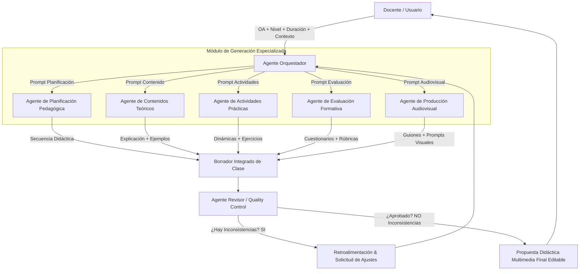

# Documento de Propuesta Técnica
## Proyecto 3: Sistema de IA Multiagente para el Diseño de Clases Multimedia Coherentes y Editables

---

### 1. Resumen Ejecutivo
El presente proyecto aborda la problemática de la **desalineación pedagógica, curricular y comunicacional** que ocurre al utilizar modelos de Inteligencia Artificial Generativa aislados o monolíticos para la preparación de material educativo.

Nuestra propuesta consiste en el desarrollo de un **Sistema de Inteligencia Artificial Multiagente** coordinado por un **Agente Orquestador** y auditado por un **Agente Revisor**. El sistema recibe como insumo inicial un *Objetivo de Aprendizaje (OA), el nivel educativo, la duración estimada y características generales del curso*, y genera como resultado una **propuesta didáctica multimedia completa, coherente y totalmente editable** por el docente.

---

### 2. Justificación del Enfoque Multiagente vs. Monolítico

#### ¿Por qué falla un único prompt o LLM monolítico?
- **Alucinación y dispersión de objetivos:** Al intentar generar planificación, contenido, actividades, evaluación y guiones en un solo llamado, el modelo pierde el foco sobre el Objetivo de Aprendizaje (OA).
- **Inconsistencia de tono y nivel:** La explicación teórica puede redactarse para nivel universitario mientras que la actividad práctica resulta demasiado infantil o simple.
- **Ausencia de control de calidad intrínseco:** Los modelos de lenguaje tienden a ser "complacientes" y no evalúan de forma crítica si la evaluación propuesta realmente mide lo especificado en el OA.

#### Ventajas de la Arquitectura Multiagente Especializada
- **Especialización por roles (Division of Concerns):** Cada agente posee prompts del sistema (*system prompts*) y *skills* optimizadas exclusivamente para su dominio didáctico.
- **Revisión cruzada e iteración:** El Agente Revisor actúa como un auditor de calidad independiente con potestad para rechazar borradores y solicitar reescrituras antes de entregar el producto final.
- **Control granular para el docente:** El docente no recibe un bloque inmutable de texto, sino módulos estructurados (planificación, texto, actividades, evaluación, recursos) que puede modificar individualmente.

---

### 3. Arquitectura del Sistema y Flujo de Información



---

### 4. Especificación Detallada de Agentes y Skills

| Agente | Responsabilidad Principal | Skills Específicas | Formato de Salida |
| :--- | :--- | :--- | :--- |
| **Orquestador** | Coordinación del flujo, parametrización y compilación. | • Extracción de metadatos pedagógicos<br>• Asignación de tareas paralelas/secuenciales<br>• Ensamble de plantilla modular | JSON Estructurado de Clase |
| **Planificador Pedagógico** | Diseño del marco temporal y metodológico de la clase. | • Dosificación de tiempos (Inicio, Dev, Cierre)<br>• Definición del modelo didáctico (ABP, 5E, Aula Invertida)<br>• Prerrequisitos y aprendizajes esperados | Esquema temporal didáctico |
| **Contenidos Teóricos** | Elaboración del cuerpo conceptual de la clase. | • Redacción conceptual clara adaptada al nivel<br>• Generación de ejemplos del mundo real y analogías<br>• Glosario de términos clave | Texto enriquecido / Markdown |
| **Actividades Prácticas** | Creación de experiencias de aprendizaje activo. | • Dinámicas grupales e individuales<br>• Preguntas detonantes y guías de discusión<br>• Instrucciones paso a paso para estudiantes | Ficha de actividades |
| **Evaluación Formativa** | Medición del cumplimiento del OA. | • Generación de rúbricas de evaluación<br>• Quizzes / Cuestionarios interactivos con solucionario<br>• Preguntas de autoevaluación y metacognición | Instrumentos de evaluación |
| **Producción Audiovisual** | Concepción de recursos multimedia de soporte. | • Guion para video explicativo corto (escaleta)<br>• Guion para podcast o narración en audio<br>• Prompts para generación de imágenes e infografías | Guiones + Prompts |
| **Agente Revisor (QC)** | Control de calidad pedagógico y curricular. | • Matriz de alineación OA vs Componentes<br>• Comprobador de densidad y lenguaje según nivel<br>• Verificador de tiempos y recursos | Reporte de Auditoría + Score |

---

### 5. Algoritmo del Agente Revisor y Loop de Calidad

El Agente Revisor no genera contenidos nuevos directamente, sino que ejecuta una **matriz de evaluación cualitativa** sobre el borrador integrado:

```json
{
  "criterios_evaluacion": {
    "coherencia_oa_actividades": "0 - 100%",
    "coherencia_oa_evaluacion": "0 - 100%",
    "adecuacion_nivel_educativo": "0 - 100%",
    "factibilidad_duracion": "0 - 100%",
    "integracion_multimedia": "0 - 100%"
  },
  "score_global_coherencia": "0 - 100%",
  "estado": "APROBADO | REQUIERE_AJUSTES",
  "observaciones_agentes": [
    {
      "agente_destino": "Agente de Evaluación",
      "motivo": "La pregunta 3 supera el nivel de complejidad requerido para 6to de Primaria.",
      "instruccion_correccion": "Simplificar la pregunta 3 usando lenguaje concreto y ejemplos cotidianos."
    }
  ]
}
```

Si el `score_global_coherencia` es inferior al threshold configurado (p. ej. **85%**), el Revisor retorna las observaciones al Orquestador para que el agente correspondiente corrija el módulo. Este loop se repite hasta alcanzar el estándar de aprobación o un máximo de 3 iteraciones.

---

### 6. Estructura de Entradas y Salidas del Sistema

#### Entradas (Input del Docente):
- **Objetivo de Aprendizaje (OA):** "Comprender la Ley de Conservación de la Energía y aplicar el concepto a situaciones cotidianas."
- **Nivel Educativo:** Educación Secundaria (14 - 15 años).
- **Duración:** 90 minutos.
- **Características / Enfoque:** Enfoque STEM, trabajo colaborativo, aula con proyectores y computadoras.

#### Salidas (Propuesta Multimedia Editable):
1. **Plan de Clase Interactivo:** Matriz con tiempos, etapas y metodologías.
2. **Guía de Contenido Teórico:** Texto preparado con hipervínculos, glosario y analogías.
3. **Guía de Actividades:** Ficha práctica editable para distribuir a los estudiantes.
4. **Instrumento de Evaluación:** Quiz interactivo + Rúbrica en tabla.
5. **Kit Multimedia:**
   - Prompt para generar la infografía principal.
   - Escaleta/Guion de video explicativo de 3 minutos.
   - Guion de audio instructivo para el inicio de la clase.
6. **Informe de Coherencia Pedagógica:** Certificado emitido por el Agente Revisor garantizando alineación del 100%.

---

### 7. Plan de Hitos del Proyecto y Hoja de Ruta Extendida

A continuación se presenta la matriz completa de desarrollo dividida en 5 Fases y 13 Hitos:

#### FASE I: Concepción, Arquitectura y Prototipado (ESTADO: COMPLETADO)
- [x] **Hito 1:** Análisis de requerimientos didácticos y diseño de la arquitectura multiagente.
- [x] **Hito 2:** Especificación del catálogo de agentes, prompts del sistema y matriz de skills.
- [x] **Hito 3:** Desarrollo de la interfaz web interactiva (HTML5, CSS3 Glassmorphism).
- [x] **Hito 4:** Implementación del motor de simulación de orquestación, edición in-situ y exportación Markdown.

#### FASE II: Desarrollo del Backend Multiagente (ESTADO: PASOS A SEGUIR)
- [ ] **Hito 5:** Creación de la API REST en Python (FastAPI) para gestionar las solicitudes.
- [ ] **Hito 6:** Implementación de la orquestación con frameworks de agentes (LangChain, LangGraph o CrewAI).
- [ ] **Hito 7:** Integración con proveedores de LLM (OpenAI GPT-4o, Google Gemini Pro, Anthropic Claude) y ajuste de prompts.

#### FASE III: Validación Avanzada y Persistencia (ESTADO: PASOS A SEGUIR)
- [ ] **Hito 8:** Programación del loop recíproco de auto-corrección entre el Agente Revisor y los especialistas.
- [ ] **Hito 9:** Implementación de base de datos (SQLite / PostgreSQL) para almacenamiento y versionado de clases.

#### FASE IV: Generación Multimedia y Exportación Extendida (ESTADO: PASOS A SEGUIR)
- [ ] **Hito 10:** Conexión con APIs de voz sintética (ElevenLabs/gTTS) y generación de imágenes (DALL-E 3/Stable Diffusion).
- [ ] **Hito 11:** Desarrollo de exportadores a PDF maquetado, presentaciones PowerPoint (.pptx) y paquetes SCORM para LMS.

#### FASE V: Pruebas Piloto y Despliegue (ESTADO: PASOS A SEGUIR)
- [ ] **Hito 12:** Pruebas de usabilidad y validación pedagógica con docentes en aulas reales.
- [ ] **Hito 13:** Contenerización con Docker y despliegue en la nube (Render, AWS o Vercel).
